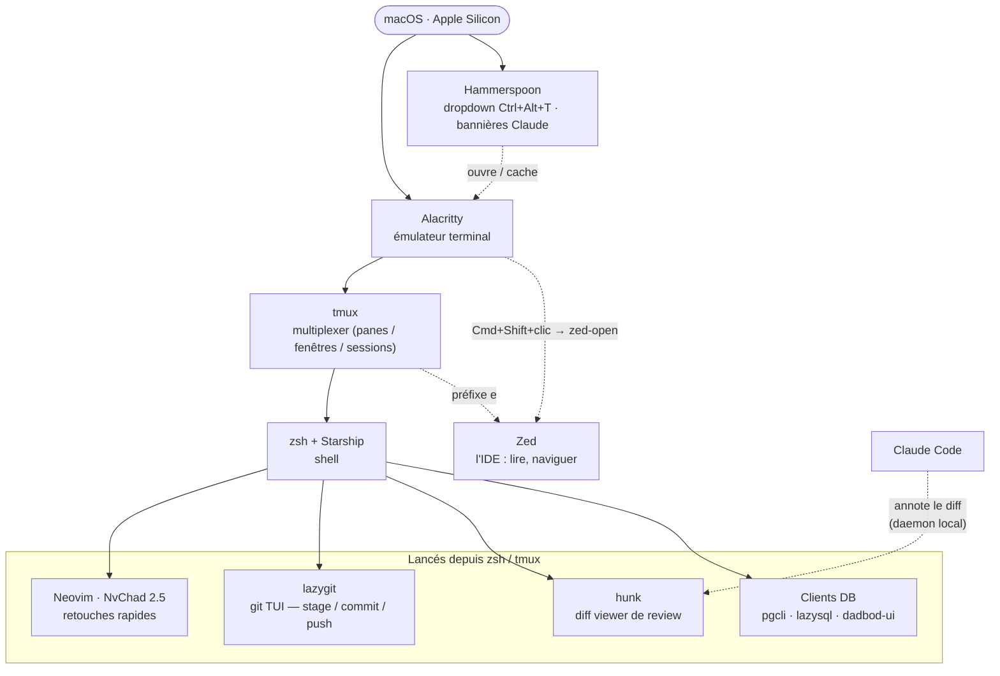
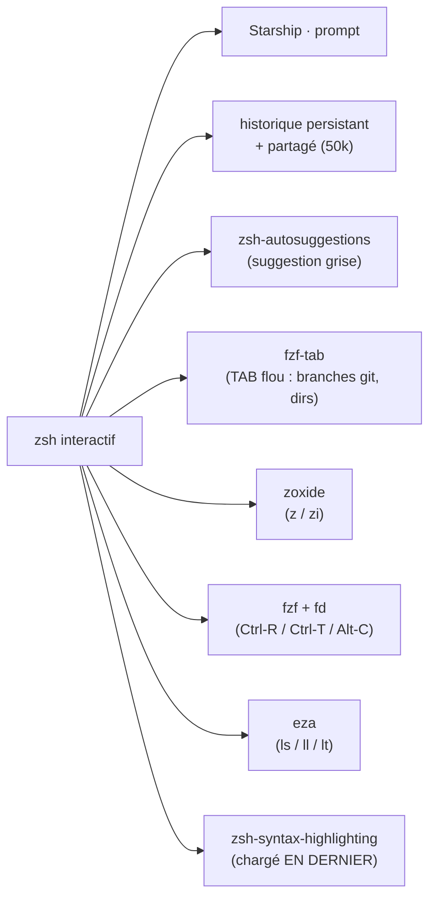
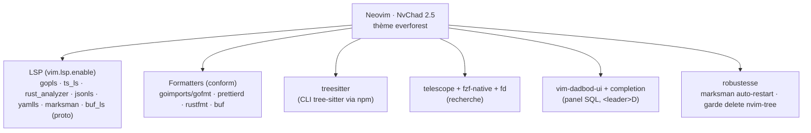
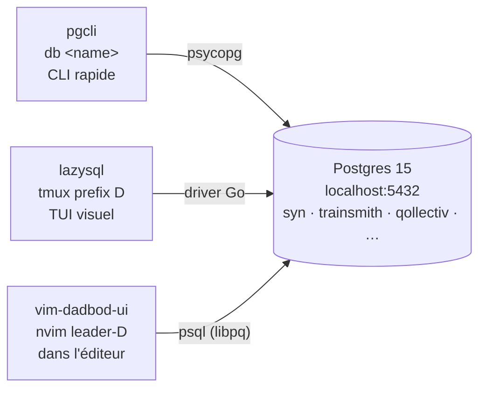
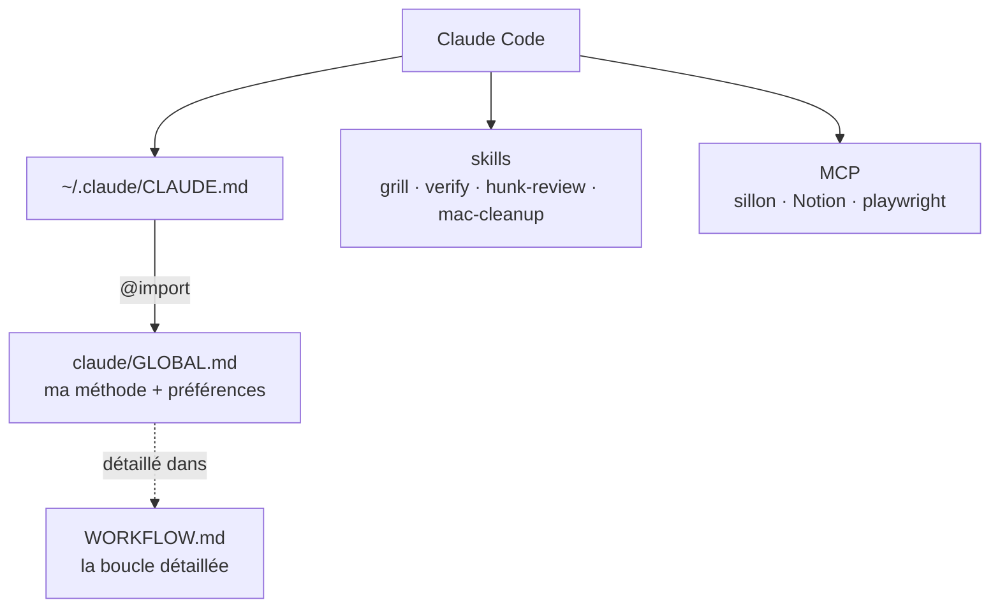
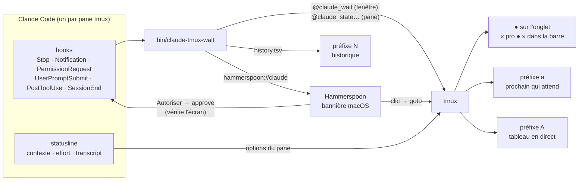
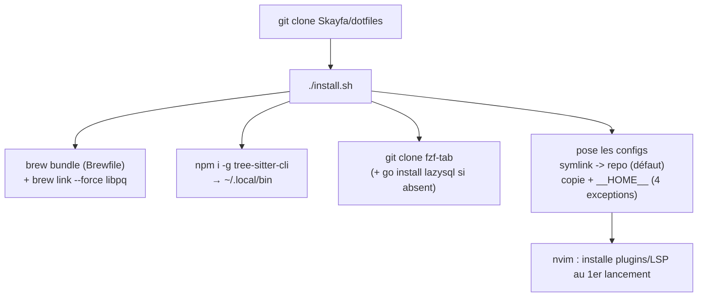

# Architecture du setup

Vue d'ensemble de **comment tout est implémenté et câblé** — du terminal jusqu'aux outils, à la couche Claude, et au repo qui versionne tout.

> Le **flux de travail** (méthode challenge → livraison fidèle) est documenté à part dans [`WORKFLOW.md`](WORKFLOW.md). Ce fichier-ci décrit l'**outillage**.

---

## 1. Le stack — les couches



**Principe** : macOS → Alacritty (terminal) → tmux (découpe l'écran, garde les sessions) → zsh (shell + prompt) → on lance lazygit / hunk / clients DB. Le code est surtout écrit par Claude : **Zed** sert à le lire et y naviguer (`préfixe e` ouvre le projet du pane, `Cmd+Shift+clic` un fichier) ; nvim reste pour une retouche rapide dans le terminal. Une seule palette partout : **Everforest Dark**.

**Git, deux outils complémentaires** : **hunk** lit le changeset (et c'est la seule surface où Claude pose sa review, en annotations inline via un daemon local) ; **lazygit** fait le reste (stage, commit, push, branches). hunk ne sait pas commiter, lazygit ne sait pas annoter.

---

## 2. Câblage — qui déclenche quoi

| Geste                          | Couche                               | Effet                                                           |
| ------------------------------ | ------------------------------------ | --------------------------------------------------------------- |
| `Cmd+B`                        | Alacritty → tmux                     | envoie `Ctrl-b` (0x02) = **préfixe tmux**                       |
| `Shift+Entrée`                 | Alacritty                            | saut de ligne (saisie multi-ligne Claude Code)                  |
| `Cmd+Shift+clic` sur un chemin | Alacritty `[hints]` → `bin/zed-open` | ouvre le fichier dans **Zed** (résout `~`, le cwd du pane tmux) |
| `Cmd+Shift+clic` sur une URL   | Alacritty `[hints]`                  | ouvre dans le navigateur                                        |
| `Ctrl+Alt+T`                   | Hammerspoon                          | **dropdown** Alacritty (pleine hauteur, marges latérales)       |
| préfixe `g` / `G`              | tmux popup                           | **lazygit** (popup / fenêtre)                                   |
| préfixe `h` / `hd`             | tmux popup / zsh                     | **hunk** — review du changeset (Claude y annote inline)         |
| `git hdiff` / `git hshow`      | git (alias `~/.config/git/config`)   | diff / commit via **hunk** (le pager par défaut reste intact)   |
| préfixe `D`                    | tmux popup                           | **lazysql** (bases de données)                                  |
| préfixe `?`                    | tmux popup                           | aide-mémoire `tmux/cheatsheet.txt`                              |
| préfixe `e`                    | tmux → `zed`                         | ouvre le projet du pane dans **Zed**                            |
| préfixe `S` / `Tab`            | tmux popup / tmux 3.8                | changer de session / chercher fenêtre ou session                |
| préfixe `a`                    | tmux → `claude-tmux-wait next`       | aller au prochain **Claude qui t'attend** (toutes sessions)     |
| préfixe `A`                    | tmux popup → `claude-tmux-wait board`| **tableau de tous les Claude** (état, contexte, effort), en direct |
| préfixe `N`                    | tmux popup → `claude-tmux-wait history` | historique des notifications Claude                          |
| clic / « Autoriser » sur une bannière | Hammerspoon → `claude-tmux-wait goto/approve` | aller à la fenêtre / valider une permission Bash courte |
| `⌥ ←/→/↑/↓`                    | tmux (sans préfixe)                  | pane voisin s'il existe, sinon la touche passe (⌥←/→ = mot)    |
| `⌘ ←/→`                        | Alacritty                            | début / fin de ligne (Ctrl-A / Ctrl-E)                          |
| `Shift ←/→`                    | tmux (sans préfixe)                  | fenêtre précédente / suivante                                   |
| `cheat` / `Ctrl-X ?`           | zsh                                  | aide-mémoire ligne de commande (`zsh/cheatsheet.txt`)           |
| `db <name>`                    | zsh                                  | **pgcli** sur une base Postgres locale                          |
| `z <bout>`                     | zsh (zoxide)                         | saute vers un dossier fréquent                                  |
| `<leader>D` / `:DBUI`          | nvim                                 | **vim-dadbod-ui** (panel SQL)                                   |
| `:Cheat` / `<espace>?`         | nvim                                 | aide-mémoire vim (`nvim/lua/cheat.lua`)                         |

---

## 3. Le shell (zsh) — ce qui est branché



Tout est dans [`zsh/plugins.zsh`](zsh/plugins.zsh), sourcé **en dernier** par `~/.zshrc`. oh-my-zsh est installé mais **dormant** (non activé). Détail des raccourcis d'édition : [`zsh/cheatsheet.txt`](zsh/cheatsheet.txt).

---

## 4. nvim (NvChad 2.5) — retouches rapides

L'IDE du quotidien est Zed (`préfixe e`). nvim reste configuré pour éditer vite sans quitter le terminal.



Fichiers clés : [`nvim/lua/plugins/init.lua`](nvim/lua/plugins/init.lua) (plugins), [`nvim/lua/configs/lspconfig.lua`](nvim/lua/configs/lspconfig.lua) (LSP + auto-restart marksman), [`nvim/lua/mappings.lua`](nvim/lua/mappings.lua) (`<leader>D`, garde nvim-tree), [`nvim/lua/chadrc.lua`](nvim/lua/chadrc.lua) (thème).

**D'où viennent les LSP** : tous via **mason** (`mason-tool-installer`, liste dans `plugins/init.lua`), **sauf `rust_analyzer` et `rustfmt`** qui viennent de **rustup** (`install.sh` fait `rustup component add rust-analyzer rust-src`). Raison : rust-analyzer doit rester accordé à la version de `rustc`, et il lit `rust-src` pour compléter la bibliothèque standard — une copie mason indépendante dériverait de la toolchain.

---

## 5. Accès base de données

Trois clients sur la **même** base locale — chacun pour un usage :



- **pgcli** → requêtes rapides en CLI (`db syn`, autocomplétion).
- **lazysql** → navigation visuelle façon lazygit (popup tmux).
- **dadbod-ui** → écrire/sauver des requêtes dans nvim (complétion des colonnes).
- Connexions par projet (ex. dolmen) = fichiers **locaux** (`~/Library/Application Support/lazysql/`, `~/.local/share/db_ui/`), **hors du repo public**.

---

## 6. La couche Claude (méthode + assistance)



### Claude ↔ toi : savoir qui t'attend

Plusieurs Claude tournent en parallèle dans tmux. Un seul script, [`bin/claude-tmux-wait`](bin/claude-tmux-wait), branché sur les hooks de Claude Code ([`claude/settings.json`](claude/settings.json)), tient tout à jour :



- **Fini** (`Stop`) ou **bloqué** (permission, question) → ● sur l'onglet, ligne d'historique, bannière (son seulement quand bloqué, aucune si Alacritty est devant).
- **Tu réponds** (`UserPromptSubmit`) ou il reprend (`PostToolUse`) → le ● s'éteint ; **il quitte** (`SessionEnd`) → le pane est oublié.
- La **commande** d'une permission vient de `PermissionRequest` (la transcription ne l'a pas encore) ; le bouton « Autoriser » ne tape `1` que si le pane montre encore cette demande pour cette commande exacte.
- **L'IA trie** (Haiku via `claude -p`, isolé : sans outils, sans MCP, depuis `/tmp`, jamais bloquant) :
  - fin de tâche → 🔴 *décision* (bannière + son), 🟡 *à relire* (bannière muette), ⚪ *info* (pas de bannière), avec un résumé d'une phrase repris dans le tableau et l'historique ;
  - permission → ce que fait vraiment l'action et son risque (✓ / ⚠ / ⛔) ; ⛔ retire le bouton « Autoriser » ;
  - toutes les 3 min (minuterie Hammerspoon, `claude-tmux-wait watch`) → un Claude qui travaille depuis 10 min et répète la même commande ou la même erreur est signalé « ⚠ boucle ».
  Si l'appel échoue, on retombe sur la bannière simple.
- **Après un redémarrage**, tmux-resurrect restaure les panes puis appelle `claude-tmux-wait restore` : chaque Claude repart avec ses options, sur la dernière conversation de son dossier (`--continue`).
- `bin/dotfiles-doctor` vérifie toute la chaîne.

`~/.claude/CLAUDE.md` importe [`claude/GLOBAL.md`](claude/GLOBAL.md) (chargé dans tous les projets). Les skills et settings vivent dans `claude/`. Les mods (plugins de hooks) vivent dans `claude/mods/`, une marketplace locale que `install.sh` installe : `dolmen-ops` pour Dolmen ([README](claude/mods/dolmen-ops/README.md)), `pilote` pour suivre un projet perso sans GitHub depuis son `pilotage/pilotage.json` ([README](claude/mods/pilote/README.md)). La boucle de travail : [`WORKFLOW.md`](WORKFLOW.md).

---

## 7. Structure du repo dotfiles

```
dotfiles/
├── install.sh            # pose tout le setup (brew bundle + symlinks vers le repo + copies __HOME__)
├── Brewfile              # dépendances Homebrew (terminal, outils, LSP, clients DB…)
├── README.md             # comment installer / utiliser
├── WORKFLOW.md           # la MÉTHODE de dev (challenge → livraison fidèle)
├── ARCHITECTURE.md       # CE fichier (l'outillage)
├── alacritty/            # alacritty.toml (couleurs Everforest, hints→zed, Cmd+B→tmux)
├── hammerspoon/          # init.lua (dropdown + bannières Claude)
├── tmux/                 # tmux.conf + cheatsheet.txt (popups, barre, tableau Claude)
├── fzf/                  # fzfrc (options + couleurs, partagé shell / popups tmux)
├── zsh/                  # plugins.zsh (UX) + aliases.zsh + cheatsheet.txt
├── starship/             # starship.toml (prompt)
├── lazygit/              # config.yml
├── hunk/                 # config.toml (diff viewer de review + annotations agent)
├── git/                  # config (alias hdiff/hshow ; l'identité reste dans ~/.gitconfig)
├── nvim/                 # config NvChad 2.5 complète (lua/…)
├── bin/                  # claude-tmux-wait · dotfiles-doctor · zed-open · hunk-log · ccw
└── claude/               # CLAUDE.md · GLOBAL.md · settings.json · skills/ · mods/
```

---

## 8. Installation (reproductible)



`install.sh` est **idempotent** : il sauvegarde toute config existante en `*.bak.<date>` avant de la remplacer.

Deux modes de pose :

| Mode                  | Helper         | Effet                                                                             |
| --------------------- | -------------- | --------------------------------------------------------------------------------- |
| **Lié** (défaut)      | `link_file`    | symlink vers le repo → éditer `~/dotfiles` est actif **tout de suite**            |
| **Copié** (exception) | `install_file` | copie + substitution `__HOME__` → `$HOME` ; il faut relancer `./install.sh`        |

Le lien est le défaut. On ne copie que si c'est impossible autrement : chemin absolu sans shell pour étendre un `~` (`alacritty.toml` → `zed-open`), ou config que l'outil **réécrit lui-même** (`lazygit/config.yml`, `claude/settings.json`, `nvim/` où lazy.nvim écrit `lazy-lock.json`) — un lien lui ferait écrire dans le repo. `link_file` refuse tout fichier contenant encore `__HOME__`, puisqu'un lien ne passe jamais par le `sed`.

---

## 9. Versionné vs local

| Versionné (repo public)                                                                                       | Local (hors repo)                                                                             |
| ------------------------------------------------------------------------------------------------------------- | --------------------------------------------------------------------------------------------- |
| Tout l'outillage générique : alacritty, tmux, zsh, nvim, starship, lazygit, hunk, fzf, hammerspoon, claude, bin, Brewfile, install.sh | Connexions DB d'un projet (`~/Library/Application Support/lazysql/`, `~/.local/share/db_ui/`) |
| La méthode (`GLOBAL.md`, skills)                                                                              | Tokens / secrets MCP (jamais commités)                                                        |
| `git/config` : le **générique** de git (alias `hdiff`/`hshow`)                                                | `~/.gitconfig` : l'**identité** git (`user.name` / `user.email`) — jamais versionnée          |
|                                                                                                               | `~/.zshrc`, `~/.tmux.conf`, `~/.config/nvim` (générés depuis le repo)                         |

**Règle** : le repo est **public** → uniquement du générique, jamais de secret. Les creds dev locaux (`user/password@localhost`) sont des defaults non-secrets.
